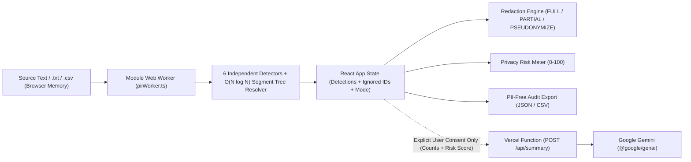

# CYLOCES — Explainable, Auditable, Local-First PII Sanitizer

> **Every redaction is explainable, reviewable, and never leaves your browser.**

## 1. Introduction

**CYLOCES** is an explainable, client-side Personally Identifiable Information (PII) inspection and sanitization workbench built with React 19, TypeScript (strict mode), Tailwind CSS v4, Vite 8, and Web Workers. An optional, explicitly opt-in serverless endpoint powered by Google Gemini (`@google/genai`) summarizes aggregate risk metrics without receiving document text or raw identifiers.

---

## 2. Problem Statement & Why It Matters

Engineering, support, and security teams routinely share application logs, incident reports, transcripts, and CSV exports across ticketing tools and external workflows. Uploading unredacted records to third-party cloud sanitizers introduces unnecessary data exposure, while blind regex scripts rarely explain _why_ tokens matched, fail to check checksums, or omit audit trails when select fields must be kept for debugging.

CYLOCES resolves this directly inside browser memory: detection, checksum validation, interactive overrides, redaction, risk scoring, and audit export generation all run locally on the client.

---

## 3. Implemented Key Features

- **Six Deterministic PII Detectors:** `EMAIL`, `PHONE`, `IPV4`, `PAN`, `AADHAAR`, and `CREDIT_CARD`.
- **Explainable Match Metadata:** Each detection records entity type, confidence (`high`, `medium`, `low`), integer severity (`1–5`), exact character offsets (`[start, end)`), span length, and human-readable validation reasons.
- **Three Redaction Modes:** `FULL` (`[REDACTED]`), `PARTIAL` (format-aware masking), and `PSEUDONYMIZE` (session-scoped normalized placeholders such as `EMAIL_01`).
- **Interactive Keep / Redact Review:** Toggle individual detections between Redacted and Kept unchanged; live sanitized output and unredacted exposure risk recalculate immediately.
- **Off-Thread Web Worker + High-Density Pagination:** Scans run in a dedicated module Web Worker with stale-response cancellation; `DetectionInspector` paginates at 50 detections/page and `SideBySideWorkspace` automatically paginates documents above 250 detections in 100-detection sections while keeping full-document downloads and audit reports complete.
- **Privacy Risk Meter (`0–100`):** Severity-weighted unredacted exposure score with `Low` (`0–25`), `Moderate` (`26–65`), and `High` (`66–100`) bands.
- **PII-Free Audit Exports:** Downloadable JSON (`cyloces-audit-report.json`) and RFC 4180-safe CSV (`cyloces-audit-report.csv`) reports containing only counts, offsets, types, and `REDACTED`/`KEPT` decisions.
- **Local File Input & Drag-and-Drop:** Supports `.txt` and `.csv` files up to 2 MB in browser memory, rejecting empty files, mismatched MIME types, and binary NUL bytes.
- **Optional Gemini AI Compliance Summary:** Disabled until the user checks consent and clicks `Generate Summary`; sends only aggregate `countsByType` and `riskScore`, with request cancellation and structured JSON error handling.

---

## 4. Architecture Overview



- **Frontend (`src/App.tsx`, `src/components/`):** Clean single-page workbench rendered solely with React text nodes (zero `dangerouslySetInnerHTML`), strict system font stacks, WCAG AA contrast, `:focus-visible` outlines, and `prefers-reduced-motion` support.
- **Detection Engine (`src/lib/detectors/`):**
  - Independent regex extraction + boundary/checksum validators (`luhn.ts` for credit cards, `verhoeff.ts` for Aadhaar, Indian holder category checks for PAN, octet range/leading-zero checks for IPv4, RFC-lite checks for email, and Indian/E.164 rules for phone).
  - Priority-ordered overlap resolution (`CREDIT_CARD > AADHAAR > PAN > IPV4 > EMAIL > PHONE`, longest match on ties, earliest start on equal length) in `src/lib/detectors/overlapResolver.ts` using coordinate compression and a `Uint8Array`-backed lazy segment tree (`IntervalOccupancyTree`) in $O(N \log N)$ time.
- **Web Worker (`src/workers/`, `src/hooks/usePiiDetectionWorker.ts`):** Offloads scanning from the main thread and discards outdated results via monotonic `requestId` tracking; uses a microtask fallback when `Worker` is absent in `jsdom` tests.
- **Redaction Engine (`src/lib/redaction/`):** Deterministic position-based replacement supporting `ignoredIds` without shifting offsets; exports pure `maskEntityValuePartially` for fast `PARTIAL` UI previews.
- **Privacy Risk Calculation (`src/lib/risk/riskCalculator.ts`):**

```text
Risk Score = round(100 * sum(severity of ignored detections) / sum(severity of all valid detections))
```

- **Optional Compliance API (`api/summary.ts`):** Vercel Web Standard Fetch handler (`export default { fetch }`) with dynamic `await import("@google/genai")`, structured JSON status codes (`400`, `403`, `405`, `413`, `415`, `500`, `502`, `503`, `504`), and `Promise.race` timeout enforcement (`12,000 ms`).

---

## 5. Three Redaction Modes

| Mode           | Behavior                                                         | Example (`alice@example.com` / `4111 1111 1111 1111`) |
| -------------- | ---------------------------------------------------------------- | ----------------------------------------------------- |
| `FULL`         | Replaces non-ignored matches with `[REDACTED]`                   | `[REDACTED]` / `[REDACTED]`                           |
| `PARTIAL`      | Preserves bounded format structure while masking core characters | `a***@example.com` / `XXXX-XXXX-XXXX-1111`            |
| `PSEUDONYMIZE` | Maps normalized matches to independent per-type session IDs      | `EMAIL_01` (same for `ALICE@example.com`) / `CARD_01` |

---

## 6. Local-First Processing & Privacy Boundaries

- **Zero document egress:** Source text, `.txt`/`.csv` files, detections, raw entity values, and pseudonym tables stay strictly inside browser RAM (`localStorage` and `sessionStorage` are never used for document text).
- **Strict CSP & Security Headers (`vercel.json`):** `default-src 'self'`, `script-src 'self'`, `style-src 'self'`, `connect-src 'self'`, `worker-src 'self' blob:`, `object-src 'none'`, `frame-ancestors 'none'`, `form-action 'self'`, `X-Frame-Options: DENY`, `X-Content-Type-Options: nosniff`, `Referrer-Policy: no-referrer`, and `Permissions-Policy`.
- **Same-origin & allowlist enforcement (`api/summary.ts`):** Enforces `POST` only, `application/json` strict media type, `Sec-Fetch-Site` cross-site blocking, `Origin` vs `Host` verification, streaming `1 KB` byte cap, and `validateComplianceRequest` rejecting unexpected fields such as `documentText`, `rawValues`, or `filename`.

---

## 7. Supported File Formats & Limits

- **Supported inputs:** Plain text paste, drag-and-drop, or `.txt` / `.csv` local file selection.
- **Upload limits (`src/lib/fileUtils.ts`):** Maximum `2 MB` (`2 * 1024 * 1024` bytes), non-empty UTF-8 text, allowed MIME types (`text/plain`, `text/csv`, `application/csv`, `application/vnd.ms-excel`, or empty browser MIME with valid extension), and binary NUL-byte (`\u0000`) rejection.
- **Sanitized downloads:** Preserve source extension (`*.sanitized-<mode>.txt` or `.csv`) and strip unsafe CSV formula/delimiter artifacts from masked tokens.

---

## 8. Installation & Local Development

Requires **Node.js `>= 22.0.0`** (CI targets Node `22`).

```bash
git clone https://github.com/Sunny-29-blip/pw2-cycloces.git
cd pw2-cycloces
npm ci
npm run dev
```

For local serverless API testing, copy `.env.example` to `.env`, set `GEMINI_API_KEY`, and run `vercel dev` (`npm run dev` serves the frontend only; core sanitization works without any backend or API key).

---

## 9. Environment Variables & Secure Gemini Setup

Configure only in server-side Vercel Project Settings (never use a `VITE_` prefix):

| Variable         | Required                   | Default                 | Purpose                                                                |
| ---------------- | -------------------------- | ----------------------- | ---------------------------------------------------------------------- |
| `GEMINI_API_KEY` | Optional (AI summary only) | —                       | Server-side Google Gemini API key read exclusively in `api/summary.ts` |
| `GEMINI_MODEL`   | No                         | `gemini-3.5-flash-lite` | Optional model override on the server                                  |

If `GEMINI_API_KEY` is unset, `POST /api/summary` cleanly returns HTTP `503` JSON while all local sanitization, scoring, and export features continue operating normally.

---

### Benchmark Performance Summary (`npm run benchmark`)

Measured synthetic PII-dense payloads (`scripts/benchmark.mjs`, before optimization vs after Prompt H segment-tree pass; logs zero raw PII):

| Payload Size           | Baseline Overlap Resolver                 | Post-Optimization Overlap (`overlapMs`) | Post-Optimization Total (`totalMs`) |
| ---------------------- | ----------------------------------------- | --------------------------------------- | ----------------------------------- |
| `64 KB` (`65,536` B)   | `55.75 ms` (`2,912` detections)           | `12.25 ms` (`2,934` detections)         | `74.47 ms`                          |
| `256 KB` (`262,144` B) | `895.52 ms` (`11,651` detections)         | `32.54 ms` (`11,737` detections)        | `202.43 ms`                         |
| `1 MB` (`1,048,576` B) | —                                         | `125.86 ms` (`46,950` detections)       | `625.95 ms`                         |
| `2 MB` (`2,097,152` B) | Timed out `> 40 s` (`~93,000` detections) | `201.96 ms` (`93,902` detections)       | `1488.95 ms`                        |

---

## 10. Testing & Benchmark Commands

```bash
npm ci
npm run lint
npm run typecheck
npm test
npm run build
npx prettier --check .
npm run benchmark
npm audit --audit-level=high
```

Vitest (`npm test`) runs all 21 unit, integration (dynamic `@google/genai` SDK mock), and UI component suites in `jsdom`; `.github/workflows/ci.yml` executes `npm ci`, ESLint, TypeScript typecheck, Prettier check, Vitest, Vite production build, and `npm audit --audit-level=high` on Node `22`.

---

## 11. Vercel Deployment Instructions & Manual Checks

1. Import `pw2-cycloces` into Vercel with Framework Preset `Vite`, Build Command `npm run build`, Output Directory `dist`, and Node.js `22.x`.
2. `vercel.json` automatically configures production CSP and security headers for static assets while Vercel deploys `api/summary.ts` at `/api/summary`.
3. **Manual Dashboard Checks Required After Deploying:**
   - Configure **Vercel WAF Rate Limiting** on `/api/summary` and **Google Cloud API quota caps** on `GEMINI_API_KEY` (serverless instances are stateless, so in-memory rate limits are not shared across instances).
   - Verify `GEMINI_API_KEY` is scoped to server-side environment variables only (not `VITE_*`), and smoke-test a consented `Generate Summary` click on production if optional AI summary is enabled.

---

## 12. Known Limitations & Future Improvements

- **Deterministic Scope Limitations:** Rule-based detection does not flag unprefixed international numbers lacking `+`, lowercase PAN strings, or contextual unstructured PII (person names, street addresses). Checksums (Luhn/Verhoeff) verify structural math, not official issuance.
- **Risk Score Scope:** Quantifies severity-weighted completely unredacted tokens, not formal k-anonymity or legal compliance; `PARTIAL` masking can still reveal domain or suffix context.
- **Test Environment Boundaries:** Automated tests run primarily in `jsdom`, complemented by headless Chromium smoke verification of `vite preview` and production HTTP `GET` header/method checks.
- **Potential Future Improvements:** User-selectable custom regex rules, client-side PDF/DOCX text extraction via offline WASM parsers, and Playwright CI integration in GitHub Actions.
