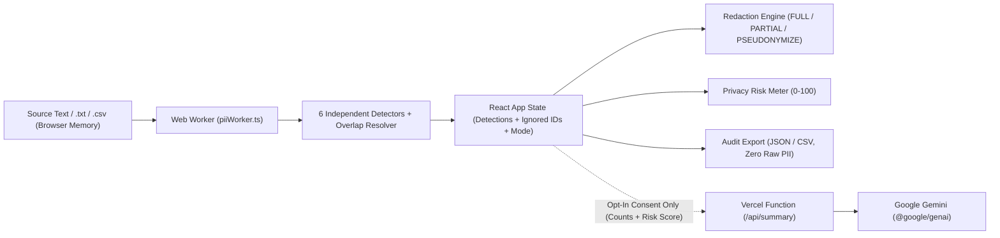

# CYLOCES — Explainable, Auditable, Local-First PII Sanitizer

> **Document text and raw identifiers remain in your browser during sanitization.**

## 1. CYLOCES Overview

**CYLOCES** is a client-side Personally Identifiable Information (PII) inspection and sanitization workbench built with React, TypeScript, Vite, Tailwind CSS, and Web Workers, paired with an optional, consent-gated Vercel serverless summary endpoint powered by Google Gemini (`@google/genai`).

---

## 2. Problem Statement

Teams frequently need to share application logs, support transcripts, incident reports, and CSV exports without exposing sensitive personal identifiers. Opaque cloud tools require uploading raw sensitive documents without explaining why tokens were flagged, how transformations work, or what exposure remains if select entities are kept for operational context.

CYLOCES performs PII detection, explainable scoring, interactive redaction, and privacy-safe audit reporting directly inside browser memory.

---

## 3. Key Features

- **Six Deterministic PII Detectors:** `EMAIL`, `PHONE`, `IPV4`, `PAN`, `AADHAAR`, and `CREDIT_CARD`.
- **Explainable Flagging:** Every detection exposes entity type, confidence (`high`, `medium`, `low`), integer severity (`1–5`), byte/character offsets, and the exact validation checks that passed.
- **Three Redaction Modes:** `FULL` (`[REDACTED]`), `PARTIAL` (format-aware masking), and `PSEUDONYMIZE` (session-local normalized placeholders like `EMAIL_01`).
- **Interactive Overrides:** Click-to-toggle any detected entity between **Redacted** and **Kept**, updating live output and risk score immediately.
- **Off-Thread Web Worker Detection:** Keeps scanning off the main UI thread with stale-response cancellation.
- **Privacy Risk Meter:** Severity-weighted `0–100` score measuring unredacted identifier exposure.
- **PII-Free Audit Exports:** Downloadable JSON and CSV audit reports containing only counts, offsets, types, and decisions.
- **Local `.txt` / `.csv` Processing:** Upload local files up to 2 MB, preview side by side, and download sanitized output preserving extensions and CSV integrity.
- **Optional Gemini Compliance Summary:** Opt-in, consent-gated summary sending only aggregate counts by type and risk score.

---

## 4. Technology Stack

| Layer                      | Technology                                              |
| -------------------------- | ------------------------------------------------------- |
| Frontend & UI              | React 19, TypeScript (Strict Mode), Tailwind CSS v4     |
| Build & Dev Server         | Vite 8                                                  |
| Off-Thread Execution       | Browser Module Web Worker (`src/workers/piiWorker.ts`)  |
| Unit & Component Tests     | Vitest 5, Testing Library (`jsdom`)                     |
| Code Quality               | ESLint 10, TypeScript ESLint, Prettier 3                |
| Optional AI Endpoint       | Vercel Node.js Fetch Function + `@google/genai`         |
| Hosting & Security Headers | Vercel + Strict Content Security Policy (`vercel.json`) |
| CI Pipeline                | GitHub Actions (`.github/workflows/ci.yml`)             |

---

## 5. Architecture Diagram



---

## 6. Detection Algorithms

Each detector runs independently with separated pattern extraction and structural/mathematical validation, followed by priority-ordered overlap resolution (`CREDIT_CARD > AADHAAR > PAN > IPV4 > EMAIL > PHONE`; longest match wins on equal priority):

- **`EMAIL`:** Practical RFC-lite local-part and domain boundary checks (`<= 254` chars, valid labels, alphabetic TLD `2–24` chars, rejecting `..` and malformed boundaries).
- **`PHONE`:** Indian 10-digit numbers starting with `6–9`, `+91` numbers (12 digits with `[6-9]` subscriber), and international `+` E.164 numbers (`7–15` digits, balanced parentheses), while rejecting dates, decimals, order prefixes, and card/Aadhaar substrings.
- **`IPV4`:** Four-octet dotted decimal validation (`0–255` per octet, rejecting multi-digit leading zeros, `999.1.1.1`, 5-octet strings, and alphanumeric boundary tokens).
- **`PAN`:** `[A-Z]{5}[0-9]{4}[A-Z]` with strict token boundaries and fourth-character holder category verification (`P, C, H, F, A, B, G, J, L, T`).
- **`AADHAAR`:** 12 continuous or `4-4-4` space-separated digits, first digit `2–9`, Verhoeff checksum validation, and boundary guards against 16-digit card substrings.
- **`CREDIT_CARD`:** `13–19` digits with optional space/hyphen grouping, Luhn checksum validation, and reliable prefix/length classification (`VISA`, `MASTERCARD`, `AMEX`, `RUPAY`, or `UNKNOWN`).

---

## 7. Checksum Validation Explanation

- **Luhn (`src/lib/detectors/luhn.ts`):** Doubles every second digit from right to left (subtracting `9` when `> 9`) and verifies `sum % 10 === 0`. Any candidate failing Luhn is discarded completely.
- **Verhoeff (`src/lib/detectors/verhoeff.ts`):** Applies the dihedral group $D_5$ multiplication and 8-row permutation tables across digits from right to left, verifying final state `=== 0`. Any candidate failing Verhoeff is discarded completely.

> Checksum validation confirms mathematical structural validity and prevents common transcription/random false positives; it does **not** prove that an identifier was officially issued or belongs to a real person.

---

## 8. Detection Confidence and Explainability

- **`high`:** All format, boundary, and checksum/issuer checks pass with strong evidence (`EMAIL`, `IPV4`, `PAN`, `AADHAAR`, `+`-prefixed `PHONE`, and `CREDIT_CARD` with a recognized issuer prefix).
- **`medium`:** Format and validation pass, but issuer or country-code context is limited (`CREDIT_CARD` passing Luhn with `UNKNOWN` issuer; domestic 10-digit Indian `PHONE` without `+91`).
- **`low`:** Reserved strictly for genuinely weaker valid rules; invalid checksums are never reported at any confidence level.
- Every detection records `reasons` directly describing the checks executed for that entity.

---

## 9. Three Redaction Modes

| Mode           | Transformation                                                                                                                                                                     | Example                                                                                                                                                                                                                                |
| -------------- | ---------------------------------------------------------------------------------------------------------------------------------------------------------------------------------- | -------------------------------------------------------------------------------------------------------------------------------------------------------------------------------------------------------------------------------------- |
| `FULL`         | Replaces non-ignored spans with `[REDACTED]`                                                                                                                                       | `sunny@example.com` -> `[REDACTED]`                                                                                                                                                                                                    |
| `PARTIAL`      | Masks sensitive portions while preserving limited format context                                                                                                                   | `sunny@example.com` -> `s***@example.com`, `4111 1111 1111 1111` -> `XXXX-XXXX-XXXX-1111`, `2345 6789 0124` -> `XXXX XXXX 0124`, `192.168.1.10` -> `192.168.*.*`, `ABCPD1234F` -> `AB*******F`, `+91 98765 43210` -> `+** ***** *3210` |
| `PSEUDONYMIZE` | Replaces normalized values with independent per-type counters (`EMAIL_01`, `CARD_01`, `AADHAAR_01`, `PAN_01`, `IPV4_01`, `PHONE_01`) scoped strictly to one sanitization operation | `sunny@example.com` & `SUNNY@example.com` -> `EMAIL_01`                                                                                                                                                                                |

---

## 10. Web Worker Architecture

- [piiWorker.ts](src/workers/piiWorker.ts) executes [processDetectionRequest](src/workers/workerMessageHandler.ts) off the main UI thread.
- [workerClient.ts](src/workers/workerClient.ts) maintains one reusable worker instance, assigns monotonic `requestId` values, discards stale responses if the user edits text before a previous scan finishes, handles worker errors cleanly, and terminates the worker on unmount.
- In test environments without `Worker` (`jsdom`), [usePiiDetectionWorker.ts](src/hooks/usePiiDetectionWorker.ts) runs an async microtask adapter executing the same message handler.

---

## 11. Privacy Risk Meter Formula and Limitations

```text
Risk Score = round(100 * sum(severity of ignored detections) / sum(severity of all valid detections))
```

- Returns `0` when there are no detections or all detections are redacted, and `100` when every detection is kept unchanged, clamped to `0–100`.
- **Bands:** `0–25` (`Low Risk`), `26–65` (`Moderate Risk`), `66–100` (`High Risk`).
- **Limitation:** Measures detected identifiers left completely unchanged; it is **not** a guarantee of anonymity, and partial masking may still leave contextual clues.

---

## 12. Audit Export Format

Both JSON (`cyloces-audit-report.json`) and RFC 4180-safe CSV (`cyloces-audit-report.csv`) exports contain **only** generation timestamp, redaction mode, total/redacted/kept counts, entity counts by type, and per-detection records (`id`, `type`, `start`, `end`, `REDACTED` or `KEPT`). Original text, raw PII values, snippets, pseudonym mappings, and filenames are never included.

---

## 13. Privacy Architecture and Network Restrictions

- Core sanitization (detection, redaction, risk scoring, file reading, and audit exports) executes 100% in browser memory with zero `localStorage`/`sessionStorage` usage for document content and zero `dangerouslySetInnerHTML`.
- Production headers in [vercel.json](vercel.json) enforce `default-src 'self'`, `script-src 'self'`, `style-src 'self'`, `connect-src 'self'`, `worker-src 'self' blob:`, `object-src 'none'`, `frame-ancestors 'none'`, and `form-action 'self'`.
- When the user **explicitly checks the consent box and clicks `Generate Summary`**, only aggregate `countsByType` and `riskScore` are sent via same-origin `POST /api/summary` to Google Gemini. Document text and raw PII are never sent and are rejected (`400`) by `api/summary.ts`.

---

## 14. Installation Instructions

```bash
git clone https://github.com/Sunny-29-blip/pw2-cycloces.git
cd pw2-cycloces
npm ci
```

---

## 15. Local Development

```bash
npm run dev
```

For testing `/api/summary` locally, copy [.env.example](.env.example) to `.env`, set `GEMINI_API_KEY`, and run `vercel dev`.

---

## 16. Testing & Benchmark Commands

```bash
npm ci
npm run lint
npm run typecheck
npm test
npm run build
npx prettier --check .
npm run benchmark
npm audit --audit-level=high
```

All Vitest unit and component suites run non-watch in `jsdom` using synthetic fixtures and mocked/dynamic `@google/genai` SDK harnesses. `npm run benchmark` evaluates `64 KB`, `256 KB`, `1 MB`, and `2 MB` synthetic PII-dense payloads without logging raw document text.

---

## 17. Vercel Deployment & Edge Security Controls

1. Import the repository into Vercel (`framework: vite`, build command `npm run build`, output directory `dist`).
2. `vercel.json` automatically applies production CSP and security headers, while `api/summary.ts` deploys as a Node.js serverless function.
3. Core sanitization works with zero environment variables configured.
4. **External Rate Limiting & Quota Protection:** Ephemeral serverless instances do not share in-memory counters; configure **Vercel WAF Rate Limiting** (and Google Cloud API quota caps / spending alerts on `GEMINI_API_KEY`) externally to protect `/api/summary` against abuse or quota exhaustion. `api/summary.ts` enforces same-origin validation (`Host` + `Origin` + `Sec-Fetch-Site`), strict `application/json` `Content-Type`, 1 KB streaming byte caps, strict allowlist validation, and deterministic `Promise.race` timeouts.

---

## 18. Environment Variables

Configure only in server-side Vercel Environment Variables (never prefix with `VITE_`):

| Variable         | Required                       | Default                 | Description                                                            |
| ---------------- | ------------------------------ | ----------------------- | ---------------------------------------------------------------------- |
| `GEMINI_API_KEY` | Optional (for AI summary only) | —                       | Server-side Google Gemini API key used exclusively in `api/summary.ts` |
| `GEMINI_MODEL`   | No                             | `gemini-3.5-flash-lite` | Configurable Gemini model identifier                                   |

---

## 19. Requirement-to-File Mapping

| Requirement                                          | Status      | File(s)                                                                                                                                                                                                                                                                                                                                                                                                                                                                                                                                                                                                                                |
| ---------------------------------------------------- | ----------- | -------------------------------------------------------------------------------------------------------------------------------------------------------------------------------------------------------------------------------------------------------------------------------------------------------------------------------------------------------------------------------------------------------------------------------------------------------------------------------------------------------------------------------------------------------------------------------------------------------------------------------------- |
| Project setup, strict TS, lint, CI, CSP              | Implemented | [package.json](package.json), [tsconfig.app.json](tsconfig.app.json), [tsconfig.node.json](tsconfig.node.json), [eslint.config.js](eslint.config.js), [vercel.json](vercel.json), [.github/workflows/ci.yml](.github/workflows/ci.yml)                                                                                                                                                                                                                                                                                                                                                                                                 |
| Detection data model & constants                     | Implemented | [src/types/detection.ts](src/types/detection.ts), [src/lib/detectors/constants.ts](src/lib/detectors/constants.ts)                                                                                                                                                                                                                                                                                                                                                                                                                                                                                                                     |
| Luhn & Verhoeff checksums                            | Implemented | [src/lib/detectors/luhn.ts](src/lib/detectors/luhn.ts), [src/lib/detectors/verhoeff.ts](src/lib/detectors/verhoeff.ts)                                                                                                                                                                                                                                                                                                                                                                                                                                                                                                                 |
| 6 PII detectors & overlap resolver                   | Implemented | [src/lib/detectors/emailDetector.ts](src/lib/detectors/emailDetector.ts), [src/lib/detectors/phoneDetector.ts](src/lib/detectors/phoneDetector.ts), [src/lib/detectors/ipv4Detector.ts](src/lib/detectors/ipv4Detector.ts), [src/lib/detectors/panDetector.ts](src/lib/detectors/panDetector.ts), [src/lib/detectors/aadhaarDetector.ts](src/lib/detectors/aadhaarDetector.ts), [src/lib/detectors/creditCardDetector.ts](src/lib/detectors/creditCardDetector.ts), [src/lib/detectors/overlapResolver.ts](src/lib/detectors/overlapResolver.ts), [src/lib/detectors/index.ts](src/lib/detectors/index.ts)                             |
| Redaction engine (`FULL`, `PARTIAL`, `PSEUDONYMIZE`) | Implemented | [src/types/redaction.ts](src/types/redaction.ts), [src/lib/redaction/fullMask.ts](src/lib/redaction/fullMask.ts), [src/lib/redaction/partialMask.ts](src/lib/redaction/partialMask.ts), [src/lib/redaction/pseudonymize.ts](src/lib/redaction/pseudonymize.ts), [src/lib/redaction/shared.ts](src/lib/redaction/shared.ts), [src/lib/redaction/index.ts](src/lib/redaction/index.ts)                                                                                                                                                                                                                                                   |
| Web Worker & React hook                              | Implemented | [src/types/worker.ts](src/types/worker.ts), [src/workers/piiWorker.ts](src/workers/piiWorker.ts), [src/workers/workerMessageHandler.ts](src/workers/workerMessageHandler.ts), [src/workers/workerClient.ts](src/workers/workerClient.ts), [src/hooks/usePiiDetectionWorker.ts](src/hooks/usePiiDetectionWorker.ts)                                                                                                                                                                                                                                                                                                                     |
| Risk Meter calculation & UI                          | Implemented | [src/types/risk.ts](src/types/risk.ts), [src/lib/risk/riskCalculator.ts](src/lib/risk/riskCalculator.ts), [src/components/PrivacyRiskMeter.tsx](src/components/PrivacyRiskMeter.tsx)                                                                                                                                                                                                                                                                                                                                                                                                                                                   |
| Audit export (JSON/CSV, PII-free)                    | Implemented | [src/types/audit.ts](src/types/audit.ts), [src/lib/audit/auditExport.ts](src/lib/audit/auditExport.ts), [src/components/AuditExportBar.tsx](src/components/AuditExportBar.tsx)                                                                                                                                                                                                                                                                                                                                                                                                                                                         |
| Interactive review UI, sample, file I/O              | Implemented | [src/App.tsx](src/App.tsx), [src/lib/sampleDocument.ts](src/lib/sampleDocument.ts), [src/lib/fileUtils.ts](src/lib/fileUtils.ts), [src/lib/documentSegments.ts](src/lib/documentSegments.ts), [src/components/Header.tsx](src/components/Header.tsx), [src/components/InputPanel.tsx](src/components/InputPanel.tsx), [src/components/ModeSelector.tsx](src/components/ModeSelector.tsx), [src/components/DetectionSummary.tsx](src/components/DetectionSummary.tsx), [src/components/SideBySideWorkspace.tsx](src/components/SideBySideWorkspace.tsx), [src/components/DetectionInspector.tsx](src/components/DetectionInspector.tsx) |
| Optional Gemini summary & validation                 | Implemented | [api/summary.ts](api/summary.ts), [src/types/compliance.ts](src/types/compliance.ts), [src/lib/complianceValidation.ts](src/lib/complianceValidation.ts), [src/lib/complianceClient.ts](src/lib/complianceClient.ts), [src/components/AiComplianceSummary.tsx](src/components/AiComplianceSummary.tsx)                                                                                                                                                                                                                                                                                                                                 |

---

## 20. Known Limitations

- Deterministic pattern detection cannot guarantee 100% recall or precision across arbitrary unstructured prose (e.g., unprefixed non-Indian phone numbers, lowercase PAN strings, or contextual non-pattern PII such as free-form person names and street addresses).
- Checksum validation verifies structural integrity, not real-world issuance.
- Overlap resolution runs in `O(N log N)` via coordinate compression and an interval-occupancy segment tree (`src/lib/detectors/overlapResolver.ts`), while high-density documents (`> 250` detections) paginate `SideBySideWorkspace` (100 detections per section) and `DetectionInspector` (50 detections per page) while keeping full-document downloads and audit exports complete.
- The Privacy Risk Meter quantifies unredacted severity weight and does not constitute a formal anonymity or legal/regulatory compliance certification.
- Automated verification runs in Vitest (`jsdom`) and Vite production builds; end-to-end live browser Web Worker and live Vercel/Gemini deployment behavior should be smoke-tested in a live browser after deploying.
